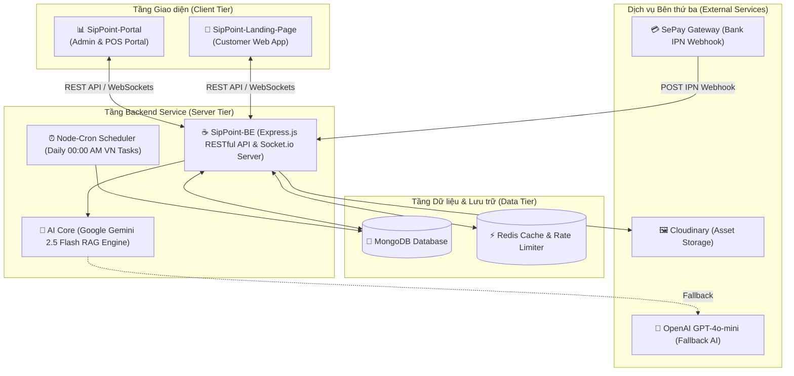

# ☕ SipPoint - Backend API Service

[](https://nodejs.org/)
[](https://expressjs.com/)
[](https://www.mongodb.com/)
[](https://redis.io/)
[](https://socket.io/)
[](https://ai.google.dev/)
[](http://localhost:5000/api-docs)

**SipPoint-BE** là trung tâm dữ liệu và dịch vụ Backend API cốt lõi được xây dựng bằng **Node.js, Express.js (ES Modules) và MongoDB**, phục vụ toàn bộ hạ tầng xử lý nghiệp vụ cho chuỗi cửa hàng cà phê & trà sữa thông minh **SipPoint Coffee & Tea**.

---

## 🌐 1. Tổng quan Kiến trúc Hệ sinh thái SipPoint

Hệ sinh thái **SipPoint** là một nền tảng chuyển đổi số toàn diện cho chuỗi F&B, bao gồm 3 dự án độc lập kết nối qua kiến trúc RESTful API và WebSockets thời gian thực:



---

## 🚀 2. Phân hệ Nghiệp vụ Cốt lõi (Core Modules)

### ☕ 2.1. Quản lý Thực đơn, Biến thể & Giá (Catalog & Pricing Engine)
- **Danh mục & Sản phẩm**: Đa dạng danh mục (Cà phê, Trà sữa, Đá xay, Bánh ngọt...).
- **Biến thể linh hoạt**: Hỗ trợ nhóm biến thể Size (M, L) và Toppings đi kèm (Trân châu, Khúc bạch, Milkfoam...).
- **Quản lý giá (ProductPrice)**: Quản lý giá gốc, giá điều chỉnh theo biến thể và bảng giá thời điểm.

### 🛒 2.2. Xử lý Đơn hàng & POS Real-time
- **Đa dạng hình thức đơn**: Ăn tại chỗ (`DINE_IN`), Mang về (`TAKEAWAY`), Giao hàng (`DELIVERY`) và Thu ngân (`COUNTER`).
- **Sơ đồ Khu vực & Bàn**: Quản lý **Zone** và **Table** với trạng thái cập nhật tức thì (`available`, `occupied`, `cleaning`).
- **Bảng Kanban & Đồng bộ Realtime**: Nhận đơn trực tiếp từ Customer App, phát thông báo WebSocket (`Socket.io`) tức thì tới màn hình Thu ngân & Bếp.

### 💳 2.3. Thanh toán & Tự động Đối soát (SePay Gateway Integration)
- **Hỗ trợ phương thức**: Tiền mặt (`CASH`), Chuyển khoản ngân hàng (`TRANSFER`), Thẻ (`CARD`).
- **Đối soát tự động qua SePay Webhook**: Nhận dữ liệu giao dịch ngân hàng thời gian thực qua SePay IPN Webhook, tự động trích xuất mã đơn `OD-XXXXXX-XXXX`, cập nhật đơn hàng thành `PAID` và phát thông báo tới Client.

### 🎯 2.4. CRM Khách hàng & Hạng Hội viên (Loyalty & Tiers)
- **Tích điểm tự động**: Cộng điểm SipPoints tự động dựa trên tổng tiền hóa đơn thanh toán thành công (Tỷ lệ mặc định: 10.000đ = 1 điểm).
- **Phân hạng thẻ hội viên (Membership Tiers)**: Hỗ trợ 4 cấp bậc (Đồng, Bạc, Vàng, Kim Cương) với các ưu đãi chiết khấu riêng.
- **Tính toán cuộn tròn 12 tháng**: Tự động tính toán nâng/hạ hạng thẻ theo chu kỳ 12 tháng qua Cron Job.

### 🎡 2.5. Trò chơi May mắn (Lucky Game / Lucky Wheel)
- **Thuật toán quay thưởng theo tỷ lệ %**: Cấu hình xác suất trúng thưởng cho từng ô (Voucher, Điểm thưởng, Lời chúc).
- **Cấp lượt chơi tự động**: Cấp lượt chơi khi khách hoàn thành đơn hàng hoặc điểm danh hàng ngày.
- **Tự động trao quà**: Đẩy trực tiếp Voucher trúng thưởng vào ví cá nhân của khách hàng.

### 👥 2.6. Phân khúc Khách hàng Tự động (Customer Segmentation)
- **Lọc động theo tiêu chí**: Gom nhóm khách hàng tự động dựa theo tổng chi tiêu, số lượng đơn đã đặt, ngày sinh nhật, hoặc giới tính.
- **Chiến dịch Marketing hướng đối tượng**: Gửi Voucher và thông báo theo từng phân khúc khách hàng (`AUTO` hoặc `MANUAL`).

### 🤖 2.7. Trợ lý AI & Engine RAG (AI & Chatbot Service)
- **RAG Kiến thức Hệ thống**: Tra cứu thông tin thực đơn, giá cả, ưu đãi và chính sách từ cơ sở dữ liệu tài liệu (`Document`).
- **Cơ chế Fallback Đa tầng**:
  1. Sử dụng **Google Gemini 2.5 Flash** (Primary Key).
  2. Tự động chuyển sang **Google Gemini Backup Key** nếu khóa chính hết quota.
  3. Tự động chuyển sang **OpenAI GPT-4o-mini** nếu cả 2 khóa Gemini gặp sự cố.

### 📦 2.8. Quản lý Kho Nguyên liệu & Công thức (Inventory Ledger)
- **Quản lý Định lượng**: Thiết lập định lượng nguyên liệu (g, ml, kg...) cho từng sản phẩm.
- **Cơ chế Hold/Commit Tồn kho**: Tạm giữ (Hold) kho khi đơn vừa tạo và chính thức trừ kho (Consume) khi đơn hoàn thành.
- **Cảnh báo hết hàng**: Tự động tính toán số lượng tồn và cảnh báo khi nguyên liệu xuống dưới ngưỡng an toàn (`LOW` / `OUT_OF_STOCK`).

### 📑 2.9. Báo cáo & Ca làm việc (Shifts & Analytics)
- **Quản lý Ca làm (Shift)**: Khởi tạo ca, ghi nhận tiền két đầu ca, chốt két cuối ca, tính chênh lệch tiền mặt và tiền chuyển khoản.
- **Xuất báo cáo Excel / PDF**: Xuất báo cáo doanh thu, lịch sử ca làm, báo cáo tồn kho ra file `.xlsx` hoặc `.pdf`.

---

## 📡 3. Danh mục API Endpoints Chi tiết

| Phân hệ (Module) | HTTP Method | Endpoint | Mô tả chức năng | Quyền (Auth) |
|---|---|---|---|---|
| **Auth** | `POST` | `/api/v1/auth/register` | Đăng ký tài khoản | Public |
| **Auth** | `POST` | `/api/v1/auth/login` | Đăng nhập hệ thống (Lấy Access Token) | Public |
| **Auth** | `POST` | `/api/v1/auth/refresh-token` | Làm mới Access Token bằng Refresh Token | Public |
| **Auth** | `GET` | `/api/v1/auth/google` | Đăng nhập Google OAuth2 | Public |
| **Catalog** | `GET` | `/api/v1/products` | Lấy danh sách sản phẩm & lọc theo danh mục | Public |
| **Catalog** | `POST` | `/api/v1/products` | Thêm mới sản phẩm | Admin / Manager |
| **Catalog** | `PUT` | `/api/v1/products/:id` | Cập nhật sản phẩm | Admin / Manager |
| **Orders & POS** | `GET` | `/api/v1/orders` | Danh sách đơn hàng (Phân trang, lọc status/date) | Staff / Manager |
| **Orders & POS** | `POST` | `/api/v1/orders` | Tạo đơn hàng mới | All Users |
| **Orders & POS** | `PATCH` | `/api/v1/orders/:id/status` | Cập nhật trạng thái đơn (PENDING ➔ COMPLETED) | Staff / Manager |
| **Payment (SePay)** | `POST` | `/api/v1/payments/sepay/create` | Khởi tạo giao dịch thanh toán SePay | Authenticated |
| **Payment (SePay)** | `POST` | `/api/v1/payments/sepay/ipn` | Webhook IPN nhận kết quả chuyển khoản | Public (SePay Server) |
| **Loyalty & Customer**| `GET` | `/api/v1/customers/me` | Lấy thông tin tài khoản & điểm thưởng cá nhân | Customer |
| **Loyalty & Customer**| `GET` | `/api/v1/customers/me/vouchers` | Danh sách voucher trong ví cá nhân | Customer |
| **Lucky Game** | `POST` | `/api/v1/lucky-game/play` | Thực hiện lượt quay trò chơi may mắn | Customer |
| **AI Chatbot** | `POST` | `/api/v1/ai/chat` | Trò chuyện với Trợ lý AI (RAG Engine) | Public / Customer |
| **Inventory** | `GET` | `/api/v1/materials` | Quản lý danh sách kho nguyên liệu | Manager / Staff |
| **Shifts** | `POST` | `/api/v1/shifts/close` | Chốt két ca làm việc cuối ngày | Cashier / Manager |

---

## 🗄️ 4. Mô hình Cơ sở Dữ liệu (Database Schemas)

| Tên Model (Mongoose) | Tên Collection | Chức năng & Vai trò chính |
|---|---|---|
| `User` | `users` | Tài khoản hệ thống (Admin, Manager, Cashier, Barista, Staff) |
| `Customer` | `customers` | Tài khoản khách hàng, điểm tích lũy SipPoints, hạng hội viên |
| `Product` | `products` | Thông tin món uống, giá bán, danh mục, hình ảnh |
| `Category` | `categories` | Danh mục sản phẩm (Cà phê, Trà, Đá xay...) |
| `Order` | `orders` | Đơn hàng, tổng tiền, phương thức thanh toán, trạng thái |
| `OrderItem` | `orderitems` | Chi tiết từng món trong đơn, biến thể Size/Topping đã chọn |
| `Table` | `tables` | Sơ đồ bàn ăn, vị trí khu vực, trạng thái sử dụng |
| `Zone` | `zones` | Khu vực cửa hàng (Tầng 1, Tầng 2, Sân thượng) |
| `Voucher` | `vouchers` | Mã giảm giá, điều kiện áp dụng, hạn sử dụng |
| `CustomerVoucher` | `customervouchers` | Ví voucher cá nhân của từng khách hàng |
| `LuckyGame` | `luckygames` | Cấu hình chương trình Trò chơi may mắn & danh sách ô quà |
| `Material` | `materials` | Kho nguyên liệu pha chế, số lượng tồn, ngưỡng cảnh báo |
| `Shift` | `shifts` | Ca làm việc nhân viên, số tiền ban đầu, số tiền chốt két |

---

## 🛡️ 5. Bảo mật, Hiệu năng & Middleware Architecture

- **NoSQL Injection Sanitization**: Tự động lọc bỏ các ký tự độc hại MongoDB (`$`, `.`) trong request parameters & body.
- **XSS Attack Protection**: Triệt tiêu toàn bộ mã độc Script / HTML trong payload đầu vào bằng middleware lọc dữ liệu.
- **Redis Rate Limiting**: Sử dụng `ioredis` giới hạn tần suất gọi API (VD: 100 requests / 15 phút / IP) chống tấn công DDoS.
- **Authentication & RBAC**: Mã hóa mật khẩu bằng `bcryptjs`, xác thực bằng JSON Web Token (JWT Access & Refresh Token) và phân quyền chặt chẽ theo Role (`ADMIN`, `MANAGER`, `CASHIER`, `BARISTA`, `STAFF`, `CUSTOMER`).
- **Security Headers (Helmet)**: Bật đầy đủ các tiêu chuẩn bảo mật HTTP (`nosniff`, `DENY`, `XSS Protection`, `HSTS`).

---

## ⚙️ 6. Biến môi trường (`.env`)

Tạo tệp `.env` tại thư mục gốc từ mẫu `.env.example`:

| Tên biến | Kiểu dữ liệu | Mô tả chi tiết | Ví dụ |
|---|---|---|---|
| `PORT` | Number | Cổng lắng nghe của HTTP Server | `5000` |
| `NODE_ENV` | String | Môi trường ứng dụng (`development` / `production`) | `development` |
| `MONGO_URI` | String | Chuỗi kết nối MongoDB (Local hoặc Atlas) | `mongodb://localhost:27017/sippoint` |
| `JWT_SECRET` | String | Khóa mã hóa JWT Access Token | `your_super_jwt_secret` |
| `SESSION_SECRET` | String | Khóa bảo mật Session | `your_session_secret` |
| `GEMINI_API_KEY` | String | Khóa Google Gemini AI API chính | `AIzaSy...` |
| `GEMINI_API_KEY_BACKUP`| String | Khóa Google Gemini AI dự phòng | `AIzaSyBackup...` |
| `OPENAI_API_KEY` | String | Khóa OpenAI API (Fallback RAG) | `sk-proj-...` |
| `SEPAY_ENV` | String | Môi trường SePay (`sandbox` / `live`) | `sandbox` |
| `SEPAY_MERCHANT_ID` | String | Mã định danh Merchant trên SePay | `MERCHANT_123` |
| `SEPAY_SECRET_KEY` | String | Khóa bí mật cấu hình SePay IPN Webhook | `SECRET_ABC123` |
| `REDIS_URL` | String | URL kết nối Redis Cache & Rate Limiting | `redis://localhost:6379` |
| `SERVER_URL` | String | Domain public của Server Backend | `http://localhost:5000` |
| `FRONTEND_URL` | String | Domain public của Customer Web App | `http://localhost:5173` |

---

## 💻 7. Hướng dẫn Cài đặt & Chạy Local

### 1. Cài đặt Dependencies
```bash
npm install
```

### 2. Khởi chạy Server Môi trường Development
```bash
npm run dev
```

### 3. Khởi chạy Môi trường Production
```bash
npm start
```

---

## 🚀 8. Triển khai Production (Render / VPS)

- **Platform khuyến nghị**: [Render.com](https://render.com/) hoặc VPS Ubuntu Linux quản lý qua **PM2**.
- **Build Command**: `npm install`
- **Start Command**: `npm start`
- **Tài liệu API Swagger Interactive**: Truy cập **[http://localhost:5000/api-docs](http://localhost:5000/api-docs)** khi Server đang khởi chạy.
